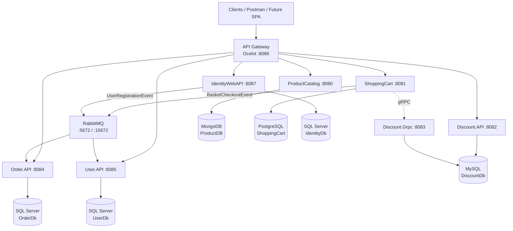
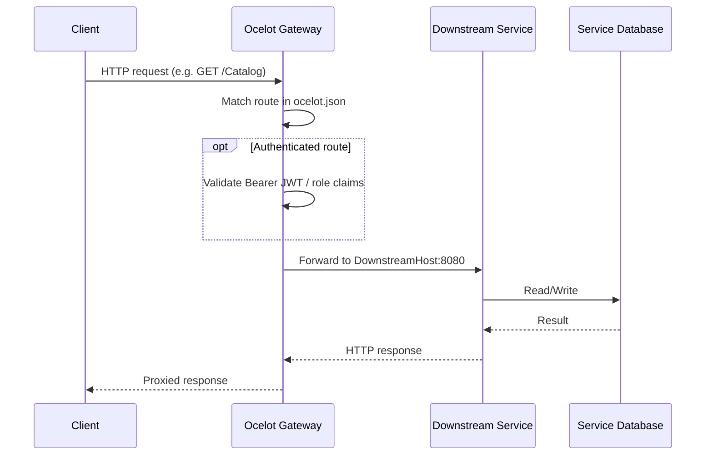
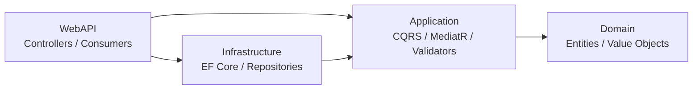
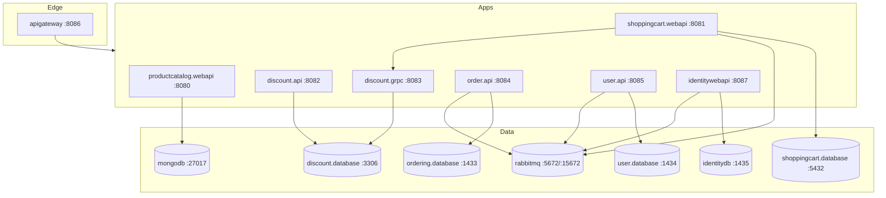
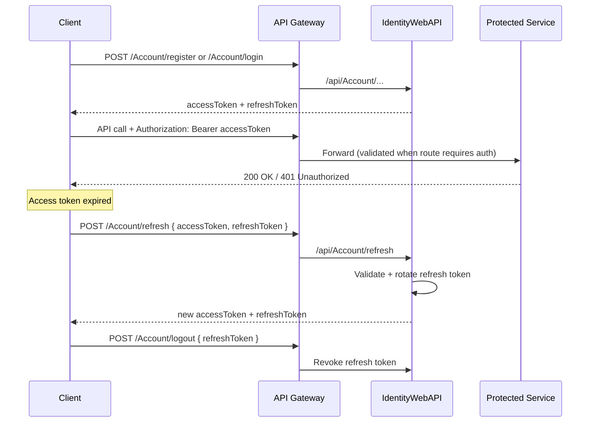
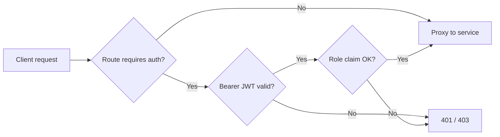
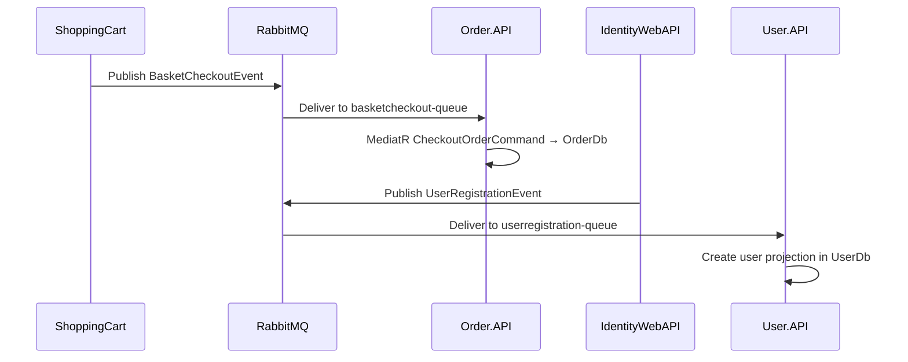
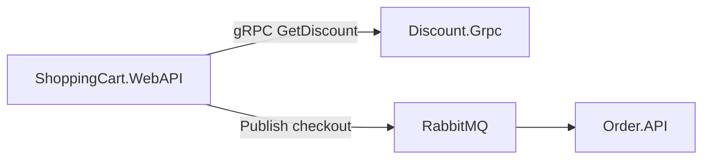
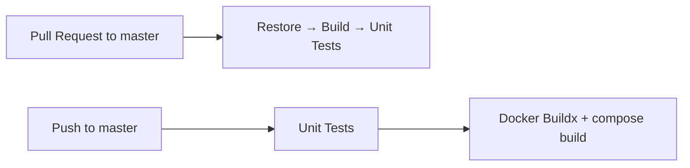

# 🛒 E-Commerce Solution — .NET Microservice Architecture

[](https://dotnet.microsoft.com/)
[](https://www.docker.com/)
[](https://github.com/ThreeMammals/Ocelot)
[](https://www.rabbitmq.com/)
[](https://github.com/rabbi1123/E-Commerce-Solution-.NET-Microservice-Architecture/actions)
[](./LICENSE)
[](./README.md#contributing)

A production-oriented **e-commerce backend** built with **.NET 8 microservices**. The solution demonstrates enterprise patterns such as **API Gateway routing**, **JWT + refresh-token authentication**, **database-per-service**, **CQRS**, **Clean Architecture**, and **event-driven communication** over **RabbitMQ** (MassTransit).

> **Single entry point for clients:** `http://localhost:8086` (Ocelot API Gateway)

---

## ✨ Features

| Area | Capabilities |
|------|----------------|
| **Catalog** | Create, update, delete, and query products (by id, name, category) |
| **Shopping Cart** | Add/update/get/delete cart items; checkout flow |
| **Discounts** | REST management API + high-performance gRPC lookup used by the cart |
| **Ordering** | Order creation driven by checkout events; query orders by user |
| **Identity** | Register, login, refresh, logout, forgot/reset password |
| **Users** | Profile/user records synchronized from registration events |
| **Gateway** | Centralized routing, caching (Catalog), role-based route guards |
| **Messaging** | Asynchronous publish/subscribe for checkout and user registration |
| **Containers** | Full local stack via Docker Compose (APIs + databases + RabbitMQ) |
| **Quality** | Unit tests (xUnit + Moq) and GitHub Actions CI |

---

## 🏗 Architecture

This solution follows a **distributed microservices** model with clear service boundaries, independent data stores, and asynchronous integration where consistency can be eventual.

### Core architectural principles

| Pattern / Technology | How it is applied |
|----------------------|-------------------|
| **Microservices Architecture** | Independently deployable services for Catalog, Cart, Discount, Ordering, User, and Identity |
| **Database per Service** | Each service owns its database (polyglot persistence) |
| **API Gateway (Ocelot)** | Single external endpoint; routes and caches requests to downstream APIs |
| **Identity Service** | ASP.NET Core Identity + JWT issuance and refresh-token lifecycle |
| **JWT Authentication** | Short-lived access tokens (HMAC-SHA256) with issuer/audience validation |
| **Refresh Tokens** | Opaque tokens persisted in `IdentityDb`, rotated on refresh, revocable on logout |
| **RabbitMQ (Event-driven)** | MassTransit publishes/consumes integration events across services |
| **Docker** | Per-service Dockerfiles + Compose for infra and application containers |
| **PostgreSQL** | Shopping Cart relational store (`ShoppingCart` database) |
| **Clean Architecture** | Ordering & Shopping Cart layered as Domain → Application → Infrastructure → WebAPI |
| **CQRS** | Commands/Queries via MediatR feature folders (Cart & Order) |
| **Repository Pattern** | Persistence abstracted behind repository contracts |
| **Dependency Injection** | Built-in ASP.NET Core DI for services, DbContexts, gRPC clients, MassTransit |
| **SOLID Principles** | Small focused handlers, interfaces for persistence/messaging, composition over inheritance |

### High-level architecture



### Request flow (via API Gateway)



### Clean Architecture (Ordering & Shopping Cart)



---

## 🧩 Microservices

| Service | Responsibility | Database | Technologies | Communication |
|---------|----------------|----------|--------------|---------------|
| **ApiGateway** | Edge routing, caching, route-level auth | — | .NET 8, Ocelot, CacheManager | HTTP → all APIs |
| **IdentityWebAPI** | AuthN/AuthZ, tokens, password reset | SQL Server (`IdentityDb`) | Identity, JWT, EF Core, MassTransit | REST + RabbitMQ publish |
| **ProductCatalog.WebAPI** | Product CRUD & queries | MongoDB (`ProductDB`) | MongoDB.Driver, Swagger | REST |
| **ShoppingCart.WebAPI** | Cart management & checkout | PostgreSQL (`ShoppingCart`) | EF Core, MediatR, MassTransit, gRPC client | REST + gRPC + RabbitMQ publish |
| **Discount.API** | Discount CRUD over HTTP | MySQL (`DiscountDb`) | EF Core (MySQL), Swagger | REST |
| **Discount.Grpc** | Discount lookup for cart pricing | MySQL (`DiscountDb`) | gRPC, Dapper/EF | gRPC |
| **Order.API** | Create/query orders from checkout events | SQL Server (`OrderDb`) | Clean Arch, CQRS, MediatR, MassTransit | REST + RabbitMQ consume |
| **User.API** | User profiles synced from identity | SQL Server (`UserDb`) | EF Core, MassTransit | REST + RabbitMQ consume |
| **Eventbus.Messages** | Shared integration event contracts | — | .NET class library | Referenced by publishers/consumers |

---

## 🛠 Technology Stack

### Backend
| Technology | Purpose |
|------------|---------|
| .NET 8 / ASP.NET Core | Service host & HTTP APIs |
| Ocelot | API Gateway |
| MediatR | CQRS command/query pipeline |
| FluentValidation | Request validation |
| AutoMapper | DTO ↔ entity mapping |
| ASP.NET Core Identity | User/role/password management |
| JWT Bearer | Access-token authentication |
| gRPC | Cart ↔ Discount synchronous calls |
| Swashbuckle (Swagger) | OpenAPI documentation |
| xUnit + Moq | Unit testing |

### Database
| Store | Owner service |
|-------|---------------|
| **MongoDB 7** | Product Catalog |
| **PostgreSQL 16** | Shopping Cart |
| **MySQL 8** | Discount (API + gRPC) |
| **SQL Server 2022** | Ordering, User, Identity |

### Infrastructure
| Component | Role |
|-----------|------|
| EF Core | Relational persistence & migrations |
| MongoDB Driver | Document persistence |
| Dapper | Lightweight SQL in Discount.Grpc |
| Repository abstractions | Persistence boundary |

### Messaging
| Component | Role |
|-----------|------|
| **RabbitMQ 3** (+ Management UI) | Message broker |
| **MassTransit** | Publish/subscribe abstraction |
| **Eventbus.Messages** | Shared event types & queue names |

### Containerization
| Tool | Role |
|------|------|
| Docker | Image builds per service |
| Docker Compose | Multi-container local orchestration |

### DevOps
| Tool | Role |
|------|------|
| GitHub Actions | CI (restore, test, Docker build) |
| Docker Buildx | Multi-platform-ready image builds |

---

## 📁 Project Structure

```text
E-Commerce Solution/
├── .github/
│   └── workflows/
│       └── ci.yml                 # CI pipeline (PR tests + push Docker builds)
├── LICENSE                        # MIT License
├── README.md                      # Project documentation
└── src/
    ├── E-Commerce-Microservice.sln
    ├── docker-compose.yml         # Services + databases + RabbitMQ
    ├── docker-compose.override.yml# Dev ports & ASPNETCORE settings
    ├── launchSettings.json        # Visual Studio Docker Compose profile
    ├── ApiGateways/
    │   └── ApiGateway/            # Ocelot gateway (ocelot.json)
    ├── Auth/
    │   └── IdentityWebAPI/        # Identity, JWT, refresh tokens
    ├── BuildingBlocks/
    │   └── Eventbus.Messages/     # Integration events & queue constants
    ├── Services/
    │   ├── ProductCatalog/        # Catalog microservice (MongoDB)
    │   ├── ShoppingCart/          # Clean Architecture + CQRS cart
    │   │   ├── Core/
    │   │   │   ├── ShoppingCart.Domain/
    │   │   │   └── ShoppingCart.Application/
    │   │   ├── Infrastructure/
    │   │   └── WebAPI/
    │   ├── Discount/
    │   │   ├── Discount.API/      # REST discount management
    │   │   └── Discount.Grpc/     # gRPC discount lookups
    │   ├── Ordering/              # Clean Architecture + CQRS orders
    │   │   ├── Core/
    │   │   │   ├── Order.Domain/
    │   │   │   └── Order.Application/
    │   │   ├── Infrastructure/
    │   │   └── WebAPI/
    │   └── User/
    │       └── User.API/          # User projections from events
    └── test/                      # Unit test projects per service area
```

| Folder | Purpose |
|--------|---------|
| `ApiGateways/` | Edge/BFF-style gateway configuration and host |
| `Auth/` | Central authentication and token issuance |
| `BuildingBlocks/` | Cross-cutting contracts shared by services |
| `Services/` | Business microservices and their layers |
| `test/` | Automated unit tests mirroring service structure |
| `.github/workflows/` | Continuous integration definitions |

---

## 💻 System Requirements

### Required software
- [Git](https://git-scm.com/)
- [Docker Desktop](https://www.docker.com/products/docker-desktop/) (or Docker Engine + Compose plugin)
- [.NET SDK 8.0](https://dotnet.microsoft.com/download/dotnet/8.0) (for local non-container runs & tests)
- IDE: Visual Studio 2022, Rider, or VS Code + C# Dev Kit (optional)

### Required SDK / runtime versions

| Component | Version |
|-----------|---------|
| .NET SDK | **8.0.x** |
| Target framework | `net8.0` |
| Docker Engine | **24+** recommended |
| Docker Compose | **v2** (`docker compose`) |
| Node.js | **Not required** (no frontend in this repo yet) |

### Databases (provided by Compose)
MongoDB **7**, PostgreSQL **16**, MySQL **8.0**, SQL Server **2022**

---

## 🚀 Getting Started

### 1. Clone the repository

```bash
git clone https://github.com/rabbi1123/E-Commerce-Solution-.NET-Microservice-Architecture.git
cd E-Commerce-Solution-.NET-Microservice-Architecture
```

### 2. Configure environment variables

Create a `.env` file next to `src/docker-compose.yml` (or export variables in your shell):

```env
POSTGRES_PASSWORD=YourStrongPostgresPassword
MYSQL_ROOT_PASSWORD=YourStrongMySqlPassword
SA_PASSWORD=Your_strong_SA_Password123
RABBITMQ_USER=guest
RABBITMQ_PASSWORD=guest
JWT_KEY=ReplaceWithALongRandomSecretKeyAtLeast32Chars
```

> ⚠️ Use strong secrets in any shared or production environment. Never commit real credentials.

### 3. Restore NuGet packages

```bash
cd src
dotnet restore E-Commerce-Microservice.sln
```

### 4. Run databases & infrastructure (Docker)

```bash
# From the src/ directory
docker compose up -d mongodb shoppingcart.database discount.database ordering.database user.database identitydb rabbitmq
```

### 5. Run the full stack with Docker Compose

```bash
docker compose up -d --build
```

EF Core migrations are applied automatically on startup for Identity, User, Shopping Cart (Development), and Ordering (Development).

### 6. Start the API Gateway

When using Compose, the gateway starts as `apigateway` on **port 8086**.

To run only the gateway locally (services already up):

```bash
dotnet run --project ApiGateways/ApiGateway/ApiGateway.csproj
```

### 7. Run Frontend

This repository currently ships as a **backend / API platform**. There is no SPA/mobile client in-tree yet.

Point any client (Postman, Swagger, or a future React/Angular/Vue app) at:

```text
http://localhost:8086
```

Identity endpoints (via gateway):

```http
POST /Account/register
POST /Account/login
POST /Account/refresh
POST /Account/logout
```

### Quick verification

| Resource | URL |
|----------|-----|
| API Gateway | http://localhost:8086 |
| RabbitMQ Management | http://localhost:15672 |
| Identity Swagger | http://localhost:8087/swagger |
| Catalog Swagger | http://localhost:8080/swagger |
| Shopping Cart Swagger | http://localhost:8081/swagger |
| Discount Swagger | http://localhost:8082/swagger |
| Order Swagger | http://localhost:8084/swagger |
| User Swagger | http://localhost:8085/swagger |

---

## 🐳 Docker Setup

### Architecture (Compose)



### Build & run

```bash
cd src

# Build all application images
docker compose build

# Start everything
docker compose up -d

# Follow logs
docker compose logs -f apigateway identitywebapi shoppingcart.webapi order.api

# Stop & remove containers
docker compose down
```

### Published host ports

| Container | Host port |
|-----------|-----------|
| productcatalog.webapi | `8080` |
| shoppingcart.webapi | `8081` |
| discount.api | `8082` |
| discount.grpc | `8083` |
| order.api | `8084` |
| user.api | `8085` |
| apigateway | `8086` |
| identitywebapi | `8087` |
| mongodb | `27017` |
| shoppingcart.database (PostgreSQL) | `5432` |
| discount.database (MySQL) | `3306` |
| ordering.database (SQL Server) | `1433` |
| user.database (SQL Server) | `1434` |
| identitydb (SQL Server) | `1435` |
| rabbitmq / management | `5672` / `15672` |

---

## 🗄 Database

This project uses **polyglot persistence** — each microservice owns its data store and schema.

| Service | Database engine | Database / collection | Notes |
|---------|-----------------|-----------------------|-------|
| ProductCatalog | MongoDB | `ProductDB` / `Products` | Seeded sample products |
| ShoppingCart | PostgreSQL | `ShoppingCart` | EF Core migrations |
| Discount.API / Discount.Grpc | MySQL | `DiscountDb` | Shared logical DB for discounts |
| Order.API | SQL Server | `OrderDb` | EF Core migrations |
| User.API | SQL Server | `UserDb` | Created/updated from events |
| IdentityWebAPI | SQL Server | `IdentityDb` | Users, roles, refresh tokens |

### Ownership rule

> **Only the owning service may write to its database.** Cross-service data is exchanged through APIs or integration events — never by reaching into another service’s store.

---

## 🔐 Authentication

### Identity Service

`IdentityWebAPI` is the authentication authority. It uses:

- ASP.NET Core Identity (`ApplicationUser` / `ApplicationRole`)
- EF Core + SQL Server (`IdentityDb`)
- Seeded roles: **Admin** (full product permissions) and **User** (`Product.Read`)
- Permission claims of type `permission` embedded in JWTs

### JWT Authentication

| Setting | Default / value |
|---------|-----------------|
| Algorithm | HMAC-SHA256 |
| Issuer | `IdentityWebAPI` |
| Audience | `ECommerceClients` |
| Access token lifetime | **20 minutes** |
| Refresh token lifetime | **7 days** |

Access tokens include `sub`, email, roles (`role` / `ClaimTypes.Role`), and permission claims.

### Refresh Token

- Cryptographically random opaque string (64 bytes, Base64)
- Stored in `RefreshTokens` table with expiry + revoke flag
- On refresh: old token is **revoked**, new access + refresh pair is issued (rotation)
- Logout revokes the presented refresh token; password reset can revoke all tokens for a user

### Role-based Authorization

- Gateway route `/User` requires Bearer auth and role **Administrator** (configured in `ocelot.json`)
- Services can authorize using role and permission claims from the JWT
- Seeded identity roles: `Admin`, `User`

### Token flow



---

## 🌐 API Gateway

The gateway is implemented with **Ocelot** (`src/ApiGateways/ApiGateway`).

### Routing

Routes are declared in `ocelot.json`. Upstream paths are exposed to clients; downstream paths map to service containers.

| Upstream (client) | Downstream service | Methods |
|-------------------|--------------------|---------|
| `/Account/{action}` | IdentityWebAPI `/api/Account/{action}` | POST |
| `/Catalog` … | ProductCatalog `/api/Catalog` … | GET, POST, PUT, DELETE |
| `/ShoppingCart` … | ShoppingCart `/api/ShoppingCart` … | GET, POST, PUT, DELETE |
| `/ShoppingCart/Checkout` | ShoppingCart checkout | POST |
| `/Discount` … | Discount.API `/api/Discount` … | GET, POST, PUT, DELETE |
| `/Order/{userName}` | Order.API `/api/Order/{userName}` | GET |
| `/User` … | User.API `/api/User` … | GET, POST, PUT, DELETE |

Additional gateway capabilities:

- **Response caching** on Catalog list route (`TtlSeconds: 30`)
- **Rate-limit messaging** configured under `GlobalConfiguration`
- **AuthenticationOptions** + **RouteClaimsRequirement** on User routes

### Authentication flow at the gateway



---

## 📨 Messaging

Asynchronous workflows use **RabbitMQ** with **MassTransit**.

### Integration events

| Event | Publisher | Consumer | Queue |
|-------|-----------|----------|-------|
| `BasketCheckoutEvent` | ShoppingCart | Order.API (`CheckoutConsumer`) | `basketcheckout-queue` |
| `UserRegistrationEvent` | IdentityWebAPI | User.API (`UserRegistrationConsumer`) | `userregistration-queue` |

Shared contracts live in `BuildingBlocks/Eventbus.Messages`.

### Publish / subscribe flow



### Synchronous companion: gRPC

Shopping Cart calls **Discount.Grpc** synchronously when applying discounts during cart operations — a classic hybrid of sync (gRPC) + async (events) communication.



---

## 📘 API Documentation

Each HTTP microservice exposes **Swagger / OpenAPI** via Swashbuckle.

### How to access Swagger UI

| Service | Swagger UI |
|---------|------------|
| IdentityWebAPI | http://localhost:8087/swagger |
| ProductCatalog | http://localhost:8080/swagger |
| ShoppingCart | http://localhost:8081/swagger |
| Discount.API | http://localhost:8082/swagger |
| Order.API | http://localhost:8084/swagger |
| User.API | http://localhost:8085/swagger |

For gateway-level exploration, call routes through `http://localhost:8086` using Swagger on the target service as a contract reference, or import the OpenAPI JSON from each service into Postman/Insomnia.

---

## 📝 Logging

| Layer | Approach |
|-------|----------|
| Framework | ASP.NET Core built-in `ILogger<T>` |
| Controllers / consumers | Structured messages with placeholders (e.g. user ids) |

Recommended production enhancements (see [Future Improvements](#-future-improvements)):

- Centralized structured logging (Serilog / OpenTelemetry)
- Correlation IDs propagated through gateway → services → MassTransit headers
- Log aggregation (Seq, ELK, or cloud APM)

---

## ⚠ Error Handling

| Mechanism | Location / behavior |
|-----------|---------------------|
| Controller result mapping | Identity `AccountController` maps domain auth errors to HTTP 400/401/409 |
| Validation pipeline | Ordering MediatR `ValidationBehaviour` + FluentValidation → `ValidationException` |
| Domain not-found | Ordering `NotFoundException` for missing aggregates |
| gRPC faults | Discount.Grpc raises `RpcException` for invalid lookups |

### Global Exception Middleware (target pattern)

A shared middleware (planned/recommended for BuildingBlocks) should:

1. Catch unhandled exceptions
2. Map to problem-details JSON (`application/problem+json`)
3. Log with correlation id
4. Avoid leaking internals in production

Example shape:

```csharp
public sealed class GlobalExceptionMiddleware
{
    private readonly RequestDelegate _next;
    private readonly ILogger<GlobalExceptionMiddleware> _logger;

    public GlobalExceptionMiddleware(RequestDelegate next, ILogger<GlobalExceptionMiddleware> logger)
    {
        _next = next;
        _logger = logger;
    }

    public async Task InvokeAsync(HttpContext context)
    {
        try
        {
            await _next(context);
        }
        catch (Exception ex)
        {
            _logger.LogError(ex, "Unhandled exception for {Method} {Path}",
                context.Request.Method, context.Request.Path);
            context.Response.StatusCode = StatusCodes.Status500InternalServerError;
            context.Response.ContentType = "application/problem+json";
            await context.Response.WriteAsJsonAsync(new
            {
                title = "An unexpected error occurred.",
                status = 500,
                traceId = context.TraceIdentifier
            });
        }
    }
}
```

---

## ❤️ Health Checks

Health endpoints are a recommended production control-plane feature for Compose/Kubernetes orchestration.

### Recommended endpoints

| Endpoint | Purpose |
|----------|---------|
| `GET /health/live` | Process is running |
| `GET /health/ready` | DB + RabbitMQ dependencies are reachable |

Example registration:

```csharp
builder.Services.AddHealthChecks()
    .AddNpgSql(connectionString)          // ShoppingCart
    .AddSqlServer(sqlConnectionString)    // Order / User / Identity
    .AddMongoDb(mongoConnectionString)    // Catalog
    .AddRabbitMQ(rabbitConnectionString);

app.MapHealthChecks("/health/ready");
app.MapHealthChecks("/health/live", new HealthCheckOptions
{
    Predicate = _ => false
});
```

Wire these into Docker Compose `healthcheck:` blocks and gateway dependency readiness as the platform matures.

---

## 🔒 Security

| Control | Implementation |
|---------|----------------|
| **Authentication** | JWT Bearer issued by IdentityWebAPI |
| **Authorization** | Role + permission claims; gateway route claims for User APIs |
| **Password hashing** | ASP.NET Core Identity password hasher (PBKDF2) |
| **Password policy** | Digit + lowercase required; min length 6; unique email |
| **Refresh tokens** | Stored, rotated, and revocable |
| **CORS** | ShoppingCart `CorsPolicy` allows any origin/method/header (tighten for production) |
| **Secrets** | Injected via environment variables (`JWT_KEY`, DB passwords) — do not hardcode |
| **Transport** | Prefer HTTPS / TLS termination at reverse proxy in production |

---

## 🧑‍💻 Development Workflow

### Git branching strategy

| Branch | Purpose |
|--------|---------|
| `master` | Stable integration branch (CI on push/PR) |
| `feature/*` | New functionality |
| `fix/*` | Bug fixes |
| `chore/*` | Tooling, docs, CI |

Suggested flow:

1. Branch from `master`
2. Implement + add/adjust unit tests
3. Open a pull request → CI runs restore/build/test
4. Merge after review

### Code formatting

```bash
dotnet format E-Commerce-Microservice.sln
```

Follow existing project conventions: feature folders for CQRS, constructor injection, and async/await end-to-end.

### Running tests

```bash
cd src
dotnet test E-Commerce-Microservice.sln --configuration Release
```

Unit test projects:

- `ShoppingCart.Application.UnitTest`
- `Order.Application.UnitTest`
- `IdentityWebAPI.UnitTest`
- `ProductCatalog.WebAPI.UnitTest`
- `Discount.API.UnitTest`
- `Discount.Grpc.UnitTest`
- `User.API.UnitTest`

---

## 🔄 CI/CD

Pipeline definition: [`.github/workflows/ci.yml`](./.github/workflows/ci.yml)



| Trigger | Job | Steps |
|---------|-----|-------|
| **Pull request** → `master` | Build and Unit Tests | Checkout → Setup .NET 8 → restore → build → `dotnet test` |
| **Push** → `master` | Docker Build and Unit Tests | Checkout → Setup .NET 8 → test → Docker Buildx → `docker compose build` for all app services |

### Docker images built in CI

- `productcatalog.webapi`
- `shoppingcart.webapi`
- `discount.api`
- `discount.grpc`
- `order.api`
- `user.api`
- `apigateway`
- `identitywebapi`

### Deployment

Images produced by Compose/CI can be pushed to a container registry (ACR, ECR, GHCR, Docker Hub) and deployed to:

- Docker Swarm / Compose on a VM
- Kubernetes (Deployments + Services + Ingress)
- Azure Container Apps / AWS ECS

> Registry push and environment-specific deployment steps are intentionally left to your target platform configuration.

---

## 🔭 Future Improvements

- [ ] First-party web storefront (React / Angular / Blazor)
- [ ] Shared BuildingBlocks middleware for global exception handling & correlation IDs
- [ ] ASP.NET Core Health Checks on every service + Compose healthchecks
- [ ] Serilog / OpenTelemetry tracing across gateway, HTTP, gRPC, and MassTransit
- [ ] API rate limiting & JWT validation hardened at the gateway for all protected routes
- [ ] Redis caching for Shopping Cart hot paths
- [ ] Outbox pattern for reliable event publishing
- [ ] Payment & inventory microservices
- [ ] Kubernetes manifests / Helm charts
- [ ] Production CORS policies and HTTPS everywhere

---

## 🖼 Screenshots

> Place UI / tooling screenshots under `docs/images/` and update the links below.

| View | Preview |
|------|---------|
| API Gateway |  |
| Swagger — Identity |  |
| Swagger — Catalog |  |
| RabbitMQ Management |  |
| Docker Compose stack |  |

---

## 🤝 Contributing

Contributions are welcome. To keep the codebase healthy:

1. **Fork** the repository and create a feature branch.
2. Keep changes focused; match existing architecture (Clean Architecture / CQRS where already used).
3. Add or update **unit tests** for new behavior.
4. Run `dotnet test` and ensure CI would pass locally.
5. Open a **Pull Request** with a clear description of *why* the change is needed.
6. Do not commit secrets, `.env` files, or personal connection strings.

By contributing, you agree that your contributions will be licensed under the MIT License.

---

## 📄 License

This project is licensed under the **MIT License** — see the [LICENSE](./LICENSE) file for details.

```text
Copyright (c) 2025 Md.Mosfikur Rahman
```

---

## 👤 Author

**Md.Mosfikur Rahman**

- GitHub: [@rabbi1123](https://github.com/rabbi1123)
- Repository: [E-Commerce-Solution-.NET-Microservice-Architecture](https://github.com/rabbi1123/E-Commerce-Solution-.NET-Microservice-Architecture)

---

<p align="center">
  <sub>Built with .NET 8 · Ocelot · RabbitMQ · Docker · Clean Architecture</sub>
</p>
